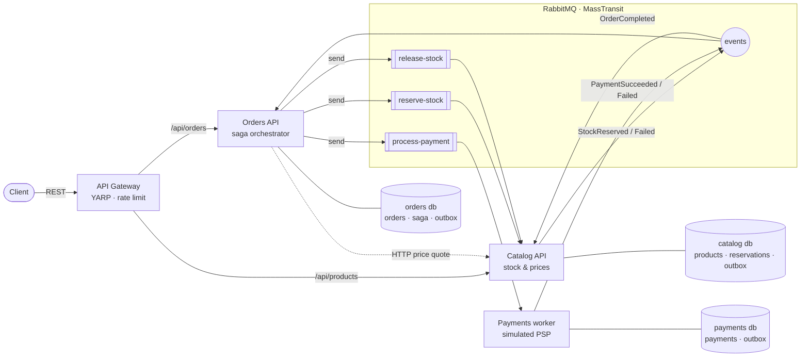
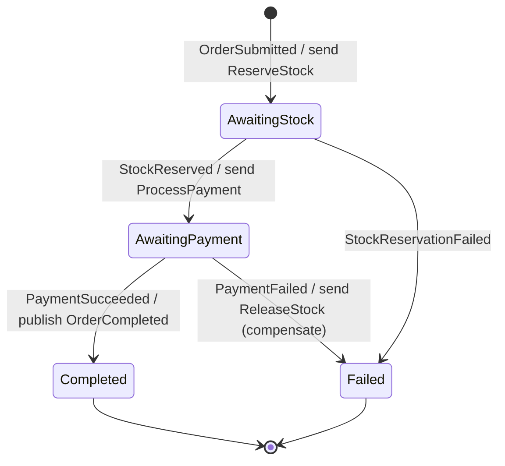
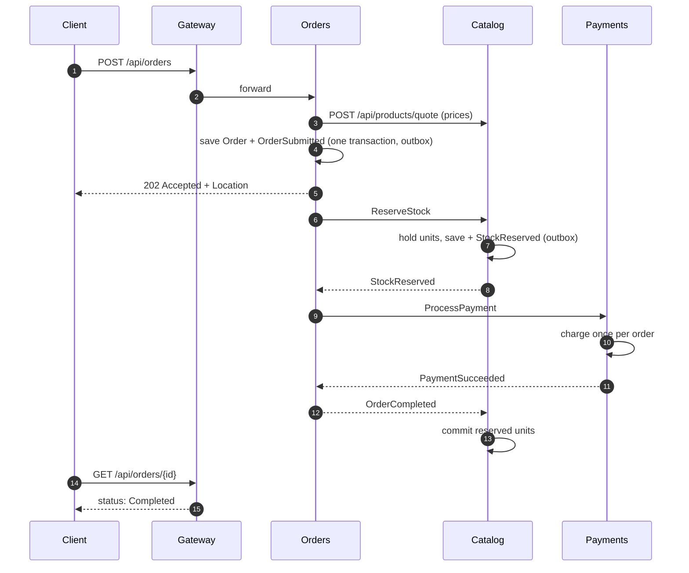

<h1 align="center">OrderFlow — event-driven order processing microservices</h1>

<p align="center">
  Four .NET services that take an order from checkout to fulfilment over RabbitMQ:
  a <b>saga</b> orchestrates stock reservation and payment, <b>compensates</b> when a step fails,
  and the <b>transactional outbox</b> guarantees no message is lost or duplicated, all observable as one distributed trace.
</p>

<p align="center">
  <a href="https://github.com/KumarNitish007/orderflow-microservices/actions/workflows/ci.yml"></a>
  
  
  
  
  
  
</p>

## What it demonstrates

| Concern | How it's solved here |
|---|---|
| **Distributed workflow** | A MassTransit **state machine saga** in the Orders service drives Reserve stock → Charge payment → Complete. State is persisted in SQL Server with optimistic concurrency. |
| **Failure handling** | Out of stock → order fails, nothing charged. Payment declined → a **compensating** `ReleaseStock` command returns the held units. Late or duplicate events after completion are ignored. |
| **Reliable messaging** | **Transactional outbox**: an order row and its `OrderSubmitted` event commit in one SQL transaction; messages go to RabbitMQ only after commit. **Inbox** de-duplication on every consumer. |
| **Idempotency** | `Idempotency-Key` header on `POST /api/orders`; reservations and payments are keyed by OrderId, so redelivery never reserves or charges twice (enforced by a unique index on payments). |
| **Concurrency** | Stock rows carry a concurrency token; two orders racing for the last unit can't both win. The loser is retried by the consumer retry policy. |
| **Database per service** | Catalog, Orders and Payments each own a database and schema; services share only message contracts. |
| **Sync where it fits** | Orders asks Catalog for authoritative prices over HTTP (service discovery + retry/timeout/circuit breaker); client-sent prices are never trusted. |
| **Edge** | **YARP** API gateway with per-client rate limiting; destinations resolved by service discovery, nothing hard-coded. |
| **Observability** | **OpenTelemetry** traces span HTTP → RabbitMQ → consumers, so one order is one trace in the Aspire dashboard. Metrics and structured logs come from every service. |
| **Local dev** | **.NET Aspire** AppHost: `dotnet run` starts SQL Server and RabbitMQ containers, all services and the dashboard. Container passwords are generated, never committed. |

## Architecture



### The order saga



### Happy path, message by message



## Run it

Prerequisites: .NET 9 SDK (projects target .NET 8) and Docker Desktop.

```bash
dotnet run --project src/OrderFlow.AppHost
```

The Aspire dashboard opens with every resource, its logs and traces. Then send requests through the gateway
(port shown in the dashboard). Sample requests are in [`requests.http`](requests.http):

```bash
# a successful order
curl -i -X POST http://localhost:<gateway-port>/api/orders -H "Content-Type: application/json" \
     -d '{"customerEmail":"buyer@example.com","items":[{"sku":"KB-MECH-01","quantity":1}]}'

# follow it
curl http://localhost:<gateway-port>/api/orders/<orderId>
```

Try the failure paths:

| Scenario | Request | Outcome |
|---|---|---|
| Payment declined | `customerEmail` starting with `decline` | `Failed` · "Card declined by issuer" · stock released |
| Over the card limit | total above ₹1,00,000 (e.g. 4 × `MON-27-4K`) | `Failed` · stock released |
| Out of stock | 10 × `SSD-NVME-1T` (only 3 in stock) | `Failed` · nothing charged |
| Unknown product | any made-up SKU | `400` validation problem |

## Tests

```bash
dotnet test tests/OrderFlow.UnitTests        # no Docker needed
dotnet test tests/OrderFlow.EndToEndTests    # needs Docker: boots the whole AppHost
```

- **Saga tests**: the state machine in isolation on the MassTransit test harness. Commands sent, states reached, compensation, duplicate events ignored.
- **In-process workflow tests**: the real saga, Catalog consumers and Payments consumer on an in-memory bus with SQLite. They prove the services agree on contracts and queue names, and check stock and payment side effects plus redelivery idempotency.
- **End-to-end tests**: [Aspire.Hosting.Testing](https://learn.microsoft.com/dotnet/aspire/testing/overview) starts SQL Server and RabbitMQ containers plus all four services, then places real orders through the gateway: completed, declined and compensated, out of stock, validation, and idempotent retry. CI runs this on every push.

## Repository layout

```
src/
├── OrderFlow.AppHost            Aspire orchestration (containers + services + dashboard)
├── OrderFlow.ServiceDefaults    OpenTelemetry, health checks, resilience, service discovery, messaging setup
├── OrderFlow.Contracts          message contracts shared by services (events & commands)
├── OrderFlow.Gateway            YARP reverse proxy + rate limiting
└── Services/
    ├── Catalog/   products, stock reservations, price quotes      (minimal API + consumers)
    ├── Orders/    order intake, saga orchestration, order status  (minimal API + saga)
    └── Payments/  payment processing worker                       (worker service + consumer)
database/          idempotent SQL scripts generated from each service's EF Core migrations
tests/             unit + workflow tests, Aspire end-to-end tests
```

Design trade-offs are written up in **[docs/decisions.md](docs/decisions.md)**.

## Roadmap

- Payment timeout via scheduled messages (RabbitMQ delayed exchange) and an expiry path for abandoned reservations
- JWT auth at the gateway with per-service authorization
- Notifications service (email/SMS on `OrderCompleted` / `OrderFailed`)
- Kubernetes manifests from the Aspire app model; Azure Container Apps deployment

## Author

**Nitish Kumar**, Senior .NET / Full Stack Developer
[Portfolio](https://kumarnitish007.github.io/portfolio-master/) · [LinkedIn](https://linkedin.com/in/nitishkumar043) · [GitHub](https://github.com/KumarNitish007)

Also see **[MiniERP](https://github.com/KumarNitish007/mini-erp-saas)**, a multi-tenant inventory and GST invoicing SaaS (.NET 8 + Angular 19).
